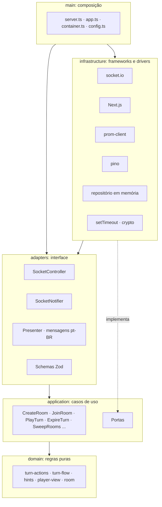

# Rouba Monte: arquitetura do backend

O backend é um único processo Node.js 24 que mantém todo o estado em memória e fala com o navegador por Socket.io. Ele segue a Arquitetura Limpa: as regras do jogo não conhecem rede, tela, relógio nem aleatoriedade.

O código é dividido em plataforma e jogos. A plataforma cuida de sala, convite, entrada, saída, reconexão, prazo do turno e contagem regressiva, e não sabe qual jogo está rodando. Cada jogo entra por uma interface comum, a `GameRules`. Hoje o único jogo é o Rouba Monte.

Em produção, a tela fica na Vercel e o servidor no Render, como serviços separados. Localmente, o `docker compose` sobe os dois num processo só.

## Camadas

| Camada | Pasta | Pode importar | Responsabilidade |
| --- | --- | --- | --- |
| Domínio | `src/domain` | só ela mesma, sem pacotes | Sala e `GameRules` em `room`; regras RN-01 a RN-21, visão por jogador e dicas em `games/rouba-monte` |
| Aplicação | `src/application` | domínio | Casos de uso e portas |
| Adaptadores | `src/adapters` | aplicação, domínio, `zod` | Contrato, validação, tradução para pt-BR |
| Infraestrutura | `src/infrastructure` | camadas internas e bibliotecas | Socket.io, HTTP, Next, métricas, logs, relógio |
| Composição | `src/main` | todas | Monta o grafo e sobe o servidor |

A regra de dependência é verificada em `test/architecture.test.ts`. O mesmo teste reprova qualquer comentário no código e qualquer import de um jogo específico dentro da plataforma.

## Plataforma e jogos

| Parte | Pasta | Conhece o jogo? |
| --- | --- | --- |
| Contrato de um jogo | `src/domain/room/game-rules.ts` | Não. Define o que todo jogo precisa ter |
| Sala, ordem de início | `src/domain/room` | Não |
| Sessão e casos de uso comuns | `src/application/room-session.ts`, `src/application/use-cases` | Não |
| Regras do Rouba Monte | `src/domain/games/rouba-monte` | Sim |
| Dicas do Rouba Monte | `src/application/use-cases/rouba-monte` | Sim |
| Contrato do Socket.io, mensagens e telas | `src/adapters/socket` | Sim, ligado ao Rouba Monte por `game.ts` |
| Escolha do jogo | `src/main/container.ts` | Sim, é onde as regras são ligadas |

A `GameRules` pede limites de jogadores e sete operações: começar, jogar, passar a vez, estourar o tempo, tirar um jogador, dizer de quem é o turno e dizer se a partida acabou. A sala usa esses limites para aceitar ou recusar entradas, e a sessão usa o número do turno para o relógio.

`test/application/second-game.test.ts` prova a separação: um jogo de mentira, a corrida até 5, roda pela mesma sala e pelos mesmos casos de uso, sem nenhuma mudança neles.

### Como adicionar um jogo

1. Criar `src/domain/games/<jogo>` com o estado, as ações e um objeto `GameRules`.
2. Criar a visão por jogador e, se o jogo tiver, as dicas.
3. Criar no adaptador o esquema Zod das ações, o presenter e as mensagens em pt-BR.
4. Ligar as regras no `container.ts`.

O passo 3 ainda é por jogo: o contrato do Socket.io só conhece o Rouba Monte. Rodar dois jogos no mesmo servidor exige escolher o jogo ao criar a sala e despachar `game:action` para o adaptador certo. Isso fica para quando o segundo jogo for escolhido.

## Decisões

| Decisão | Motivo | Alternativa descartada |
| --- | --- | --- |
| Estado imutável no motor | Ação inválida não muda nada (RF-09) | Mutação com rollback manual |
| Carta como texto (`"7H"`) | Comparação e serialização diretas, mensagens pequenas | Objetos com valor e naipe |
| Dicas recebem só `PlayerView` | RF-20 garantido pelo tipo: a função não tem acesso às outras mãos | Filtrar o estado completo |
| Conexão abstraída em `ClientConnection` | Socket.io fica só na infraestrutura | Controller acoplado ao `Socket` |
| Dicas sob demanda (`game:hints`) | Não gasta CPU com quem deixou as dicas desligadas | Calcular a cada atualização |
| Prazo do turno enviado uma vez | O cliente conta o tempo sozinho, sem mensagem por segundo | Enviar o relógio pela rede |
| Métricas em porta interna (9464) | `/metrics` não fica exposto na internet | Rota na porta pública |
| Compressão do WebSocket desligada | Mensagens pequenas não compensam a CPU gasta | `perMessageDeflate` |
| `next()` como custom server | Atende "um `server.ts` sobe os dois" | `output: standalone`, incompatível com custom server |

## Contrato

Todo comando recebe um `ack`: `{ ok: true, data }` ou `{ ok: false, error: { code, message } }`. Os tipos estão em `src/adapters/socket/contract.ts` e a validação em `schemas.ts`.

| Comando | Entrada | Resposta | Requisito |
| --- | --- | --- | --- |
| `room:create` | `{ nickname }` | código, jogador, token, convite | RF-01 |
| `room:join` | `{ code, nickname }` | igual | RF-02 |
| `room:reconnect` | `{ code, nickname, reconnectToken }` | igual | RF-06 |
| `room:leave` | nenhuma | `null` | RN-20 |
| `room:kick` | `{ playerId }` | `null` | RF-05 |
| `game:start` | nenhuma | `null` | RF-04, RF-15 |
| `game:action` | `draw`, `layDown`, `takeFromTable`, `steal` ou `discard`. A jogada fecha o turno; só a compra espera o descarte | `null` | RF-09 |
| `game:endTurn` | nenhuma. Passa a vez sem jogar | `null` | RF-10 |
| `game:hints` | nenhuma | jogadas, destaques, riscos, contador | RF-16 a RF-19 |

| Evento do servidor | Conteúdo |
| --- | --- |
| `room:state` | Estado da sala e visão da partida daquele jogador, com `version` crescente |
| `room:removed` | `{ reason: "kicked" }` |

| HTTP | Porta | Uso |
| --- | --- | --- |
| `GET /healthz` | 3000 | Processo vivo |
| `GET /readyz` | 3000 | Pronto para receber tráfego |
| `GET /metrics` | 9464 | Prometheus |

O contrato HTTP tem só esses três caminhos sem regra de negócio, então não há coleção Postman nem OpenAPI: o contrato real é o de Socket.io, validado por `test/integration/socket.test.ts`.

## Regras confirmadas

| Regra | Como funciona |
| --- | --- |
| Uma jogada por turno (RN-04) | Baixar, pegar da mesa, roubar ou descartar fecha o turno na hora, e a mão volta a ter 4 cartas |
| Comprar (RN-05) | A compra e o que vem depois contam como uma jogada só: com 5 cartas, o jogador descarta 1, pega da mesa, avança uma quadra incompleta dele ou rouba com carta da mão, e o turno fecha. Abrir quadra nova depois de comprar é recusado, e a exceção dos dois pares da RN-10 também, porque a mão ficaria com 5. Se a compra esgotar o monte, fecha na hora (RN-14) |
| Contagem regressiva | A partida começa depois de 3 segundos, contados pelo servidor. O relógio do turno só começa depois dela, e jogadas enviadas antes são recusadas |
| Passar a vez (RF-10) | O jogador pode passar sem jogar, menos depois de comprar e menos com o monte vazio. Com o monte vazio e cartas na mão, ele precisa jogar ou descartar. Decidido em 2026-11-04 |
| Desfazer (RF-12) | Removido: não sobra ação para desfazer, porque a jogada fecha o turno |
| Entrar na sala (RF-02) | Vale na sala de espera e entre uma partida e outra. Só a partida em andamento recusa a entrada |
| Pegar da mesa (RN-06) | O jogador escolhe uma ou mais cartas iguais da mesa e junta com ao menos 1 da mão. Tudo vai para a área dele, e a jogada é uma só |
| Pares iguais em duas áreas (RN-10) | Com um par do mesmo valor em cada área, as 4 cartas estão à vista e ninguém tem carta na mão para roubar. Quem jogar primeiro pode pegar o par do outro sem carta da mão e fecha a quadra |
| Ordem dos turnos (RN-03) | "Para a direita" é a ordem de entrada na sala: depois do último, volta para o primeiro. Quem sai não muda a ordem dos outros |
| Limite de salas | `MAX_ROOMS=10` no plano gratuito, o maior número medido que atendeu à meta de 1 s. Decidido em 2026-11-04 |
| Sala vazia (RNF-07) | Quando o último jogador sai pelo botão, a sala é apagada na hora. Sem ninguém conectado, ela é apagada depois de 150 s, em vez dos 10 min do documento de requisitos, para não prender as vagas do limite. Decidido em 2026-11-04 |

## Decisões onde os requisitos eram omissos ou conflitantes

O documento de requisitos do projeto não está neste repositório; os códigos RN, RF e RNF apontam para ele. Estas escolhas foram tomadas para o motor funcionar. A do impasse foi confirmada em 2026-11-03; as demais aguardam confirmação do autor.

| Ponto | Conflito | O que foi implementado |
| --- | --- | --- |
| Monte e mãos vazios com quadras faltando | O diagrama de fluxo encerrava a partida; a RN-15 diz que ela só acaba com as 13 quadras | Confirmado: vale a RN-15. A mesa volta embaralhada para o monte e é distribuída de novo. Com a mesa vazia, voltam as quadras incompletas |
| Reconexão por apelido | Com só o apelido, qualquer um da sala assumiria a mão de quem caiu, contrariando a RNF-04 | Exige apelido e um token entregue ao entrar na sala. O frontend guarda o token no navegador |
| Só 1 jogador restante | Não há regra | A partida encerra por abandono e quem ficou vence. Quem saiu, ou outro amigo, pode entrar de novo na sala |
| Tempo estourado com monte vazio | A RN-21 fala em mão diferente de 4; a RN-14 desliga essa regra | Descarta 1 carta aleatória para a partida andar |
| Anfitrião sai da sala | Não há regra | O jogador seguinte vira anfitrião |

## Limites de segurança

- Mensagem de até 4 KB, com esquema estrito por comando.
- Até 20 comandos por segundo por conexão, com rajada de 40.
- Até 30 conexões simultâneas, 10 salas novas por minuto e 3 salas abertas ao mesmo tempo por IP. Atrás de proxy, ligue `TRUST_PROXY`.
- Conexão de outro site é recusada: a origem precisa ser o próprio endereço do jogo ou estar em `CORS_ORIGIN`.
- Falha ao servir uma página responde 500 e não derruba o processo nem as salas.
- Código de sala com 6 caracteres de um alfabeto de 32 (cerca de 1 bilhão de combinações).
- Apelido nunca é registrado em log (RNF-11).
- Contêiner sem root, sistema de arquivos somente leitura e sem capabilities.
