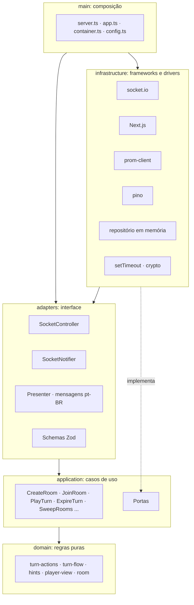

# Baralhada: arquitetura do backend

O backend é um único processo Node.js 24 que mantém todo o estado em memória e fala com o navegador por Socket.io. Ele segue a Arquitetura Limpa: as regras do jogo não conhecem rede, tela, relógio nem aleatoriedade.

O código é dividido em plataforma e jogos. A plataforma cuida de sala, convite, entrada, saída, reconexão, times, prazo do turno e contagem regressiva, e não sabe qual jogo está rodando. Cada jogo entra por uma interface comum, a `GameRules`, registrada num catálogo (`GameCatalog`). Cada sala guarda o `gameId` escolhido pelo anfitrião (RF-25), e o mesmo servidor roda salas de jogos diferentes ao mesmo tempo. Hoje há seis jogos: Rouba Monte, Truco Paulista, Três Trincas, Poker Texas Hold'em, Cacheta e Blackjack.

Em produção, a tela fica na Vercel e o servidor no Render, como serviços separados. Localmente, o `docker compose` sobe os dois num processo só.

## Camadas

| Camada | Pasta | Pode importar | Responsabilidade |
| --- | --- | --- | --- |
| Domínio | `src/domain` | só ela mesma, sem pacotes | Sala, times, catálogo e `GameRules` em `room`; regras RN-01 a RN-17 em `games/rouba-monte`; TR-RN-01 a TR-RN-16 em `games/truco` |
| Aplicação | `src/application` | domínio | Casos de uso e portas |
| Adaptadores | `src/adapters` | aplicação, domínio, `zod` | Contrato, validação, tradução para pt-BR |
| Infraestrutura | `src/infrastructure` | camadas internas e bibliotecas | Socket.io, HTTP, Next, métricas, logs, relógio |
| Composição | `src/main` | todas | Monta o grafo e sobe o servidor |

A regra de dependência é verificada em `test/architecture.test.ts`. O mesmo teste reprova qualquer comentário no código e qualquer import de um jogo específico dentro da plataforma.

## Plataforma e jogos

| Parte | Pasta | Conhece o jogo? |
| --- | --- | --- |
| Contrato de um jogo e catálogo | `src/domain/room/game-rules.ts`, `game-catalog.ts` | Não. Define o que todo jogo precisa ter |
| Sala, times, ordem de início | `src/domain/room` | Não |
| Sessão e casos de uso comuns | `src/application/room-session.ts`, `src/application/use-cases` | Não. Resolve as regras pelo `gameId` da sala |
| Regras do Rouba Monte | `src/domain/games/rouba-monte` | Sim |
| Regras do Truco Paulista | `src/domain/games/truco` | Sim |
| Regras do Poker Texas Hold'em | `src/domain/games/poker` | Sim |
| Regras da Cacheta | `src/domain/games/cacheta` | Sim |
| Regras do Blackjack | `src/domain/games/blackjack` | Sim |
| Contrato comum do Socket.io | `src/adapters/socket` | Não. Despacha para o adaptador do jogo da sala |
| Adaptador de cada jogo | `src/adapters/socket/games/<jogo>` | Sim: esquema Zod das ações, visão, dicas e frases em pt-BR |
| Catálogo de jogos | `src/main/container.ts` | Sim, é onde regras e adaptadores são registrados |

A `GameRules` declara o formato do jogo (`playerCounts`, `teamCount`, `turnDurationMs`) e seis operações: começar, jogar, estourar o tempo, tirar um jogador, dizer de quem é o turno e dizer se a partida acabou. A sala usa o formato para aceitar entradas, bloquear o início com número de jogadores não aceito ou times desiguais, e marcar o relógio de cada jogo.

Os times são da plataforma, não do Truco: um jogo com `teamCount` recebe em cada assento o time do jogador. Sem mudança do anfitrião, vale a ordem de entrada alternando; ao iniciar, os times ficam fixos na sala, e quem entra depois vai para o time menor.

`test/application/second-game.test.ts` prova a separação: um jogo de mentira, a corrida até 5, roda pela mesma sala e pelos mesmos casos de uso, inclusive ao mesmo tempo que uma sala de Rouba Monte.

### Como adicionar um jogo

1. Criar `src/domain/games/<jogo>` com o estado, as ações, a visão por jogador e um objeto `GameRules`.
2. Criar `src/adapters/socket/games/<jogo>` com o contrato, o esquema Zod das ações, o presenter, as dicas e as mensagens em pt-BR, num objeto `GameAdapter`.
3. Registrar as regras e o adaptador no `container.ts` e o tipo do estado na união de `contract.ts`.
4. No frontend, registrar o jogo em `lib/game/domain/catalog.ts` e a mesa em `components/game/room/room-screens.tsx`.

As regras dos jogos continuam isoladas da sala e dos casos de uso; o estado e os comandos comuns ficam na camada da plataforma.

## Decisões

| Decisão | Motivo | Alternativa descartada |
| --- | --- | --- |
| Estado imutável no motor | Ação inválida não muda nada (RF-09) | Mutação com rollback manual |
| Carta como texto (`"7H"`) | Comparação e serialização diretas, mensagens pequenas | Objetos com valor e naipe |
| Dicas recebem só `PlayerView` ou `TrucoView` | RF-20 garantido pelo tipo: a função não tem acesso às outras mãos | Filtrar o estado completo |
| Ação decodificada pelo adaptador do jogo da sala | O Zod de cada jogo valida dentro do mesmo comando que carrega a sala, sem janela entre ler e jogar | Um esquema único com a união de todos os jogos |
| Times na plataforma | Outros jogos de dupla reaproveitam formação, sorteio e balanceamento | Times dentro do estado do Truco |
| Truco carregado sob demanda no frontend | Quem joga Rouba Monte não baixa a mesa do Truco | Um pacote único com todas as mesas |
| Conexão abstraída em `ClientConnection` | Socket.io fica só na infraestrutura | Controller acoplado ao `Socket` |
| Dicas sob demanda (`game:hints`) | Não gasta CPU com quem deixou as dicas desligadas | Calcular a cada atualização |
| Prazo do turno enviado uma vez | O cliente conta o tempo sozinho, sem mensagem por segundo | Enviar o relógio pela rede |
| Métricas em porta interna (9464) | `/metrics` não fica exposto na internet | Rota na porta pública |
| Compressão do WebSocket desligada | Mensagens pequenas não compensam a CPU gasta | `perMessageDeflate` |
| `next()` como custom server | Atende "um `server.ts` sobe os dois" | `output: standalone`, incompatível com custom server |

## Contrato

Todo comando recebe um `ack`: `{ ok: true, data }` ou `{ ok: false, error: { code, message } }`. Os tipos estão em `src/adapters/socket/contract.ts` e a validação em `schemas.ts`.

| Comando | Entrada | Resposta | Requisito |
| --- | --- | --- | --- |
| `room:create` | `{ nickname, gameId? }` | código, jogador, token, convite | RF-01, RF-25 |
| `room:join` | `{ code, nickname }` | igual | RF-02 |
| `room:reconnect` | `{ code, nickname, reconnectToken }` | igual | RF-06 |
| `room:leave` | nenhuma | `null` | RN-16 |
| `room:kick` | `{ playerId }` | `null` | RF-05 |
| `room:game` | `{ gameId }` | `null` | RF-25 |
| `room:team` | `{ playerId, team }` | `null` | TR-RF-09 |
| `room:teams-draw` | nenhuma | `null` | TR-RF-09 |
| `room:pause` | `{ paused }` | `null` | Pausa manual pelo anfitrião; congela o relógio e o agendador |
| `game:start` | nenhuma | `null` | RF-04, RF-15 |
| `game:action` | Rouba Monte: `capture { card, tableCards }`, `stack { card }`, `steal { card, targetId }`, `discard { card }` ou `draw`. Truco: `play { card }`, `playBlind { slot }`, `raise`, `accept` ou `run`. Poker: `fold`, `check`, `call`, `bet { amount }` ou `raise { amount }`, com o valor total da aposta na rodada. Cacheta: `draw`, `take`, `discard { card }` ou `knock { card }`, com a carta que vai para o descarte. Blackjack: `bet { amount }`, `hit`, `stand`, `double` ou `split` | `null` | RF-09, RF-10, TR-RF-02 a TR-RF-08, PK-RF-03, PK-RF-04, CA-RF-03, CA-RF-04, CA-RF-06, BJ-RF-01, BJ-RF-04 a BJ-RF-06 |
| `game:hints` | nenhuma | Rouba Monte: jogadas, destaques, risco e contador. Truco: régua de força e sugestões. Poker: jogo atual e cartas que melhoram. Cacheta: jogos prontos, batida possível e sugestões. Blackjack: jogada da estratégia básica | RF-16 a RF-19, TR-RF-13, TR-RF-14, PK-RF-12, PK-RF-13, CA-RF-11, CA-RF-12, BJ-RF-13 |

| Evento do servidor | Conteúdo |
| --- | --- |
| `room:state` | Estado da sala (`gameId`, `teams`, `startProblem`, `turnDurationMs`) e a visão da partida daquele jogador, com o `kind` do jogo e `version` crescente |
| `room:removed` | `{ reason: "kicked" }` |

| HTTP | Porta | Uso |
| --- | --- | --- |
| `GET /healthz` | 3000 | Processo vivo |
| `GET /readyz` | 3000 | Pronto para receber tráfego |
| `GET /metrics` | 9464 | Prometheus |

O contrato HTTP tem só esses três caminhos sem regra de negócio, então não há coleção Postman nem OpenAPI: o contrato real é o de Socket.io, validado por `test/integration/socket.test.ts`.

## Regras confirmadas do Rouba Monte

As regras seguem a atualização do documento de requisitos de 2026-11-05: o Rouba-monte tradicional, em que vence quem termina com o maior monte. A compra foi mantida a pedido do autor no mesmo dia, com a mão sempre voltando a 4 cartas e sem passar a vez.

| Regra | Como funciona |
| --- | --- |
| Uma jogada por turno (RN-04) | Capturar, pôr no próprio monte, roubar ou descartar fecha o turno na hora |
| Comprar (RN-04) | O jogador pode comprar 1 carta por turno antes de jogar. Com 5 cartas na mão, precisa descartar, capturar, pôr no monte ou roubar, e a compra e a jogada contam como uma só. Não existe passar a vez, e com o baralho vazio não há compra |
| Capturar (RN-05) | 1 carta da mão e 1 ou mais cartas de mesmo valor da mesa, à escolha do jogador, vão para o topo do monte dele. A carta da mão fica por cima |
| Pôr no próprio monte (RN-06) | Uma carta da mão igual ao topo vai para cima do monte. Com o monte vazio, a jogada é recusada |
| Roubar (RN-07, RN-08) | A carta da mão vai para cima do monte do adversário, e esse monte inteiro vai para cima do monte de quem roubou. Cada jogada rouba 1 monte |
| Descartar (RN-09) | Sempre permitido, mesmo com captura ou roubo possível |
| Mão de 4 cartas (RN-10) | Ao fechar o turno, toda mão com menos de 4 cartas compra automaticamente até completar 4, enquanto houver baralho |
| Mesa (RN-11) | Com menos de 3 cartas, a mesa volta a 8 enquanto houver baralho |
| Baralho vazio (RN-12) | Quem está sem cartas tem a vez pulada |
| Fim (RN-13, RN-14) | Ao fechar cada turno, o servidor encerra a partida se todas as mãos estão vazias ou se o baralho acabou e ninguém tem carta para capturar, pôr no monte ou roubar. Vence o maior monte, e os empatados vencem juntos |
| Saída (RN-16) | Mão e monte de quem sai voltam ao baralho, que é embaralhado de novo |
| Tempo (RN-17) | Ao estourar os 60 s, 1 carta aleatória da mão vai para a mesa, a mão volta a 4 e o turno fecha |
| Contagem regressiva (RF-24) | A partida começa depois de 3 segundos, contados pelo servidor. O relógio do turno só começa depois dela, e jogadas enviadas antes são recusadas |
| Desfazer (RF-12) | Removido: não sobra ação para desfazer, porque a jogada fecha o turno |
| Entrar na sala (RF-02) | Vale na sala de espera e entre uma partida e outra. Só a partida em andamento recusa a entrada |
| Ordem dos turnos (RN-03) | "Para a direita" é a ordem de entrada na sala: depois do último, volta para o primeiro. Quem sai não muda a ordem dos outros |
| Baralho (seção 8) | Um baralho de 52 cartas para qualquer número de jogadores, de 2 a 6 |
| Limite de salas | `MAX_ROOMS=10` no plano gratuito, o maior número medido que atendeu à meta de 1 s. Decidido em 2026-11-04 |
| Sala vazia (RNF-07) | Quando o último jogador sai pelo botão, a sala é apagada na hora. Sem ninguém conectado, ela é apagada depois de 150 s |

Todo turno termina com uma jogada que tira 1 carta da mão, e as mãos só recebem cartas do baralho, que só cresce quando alguém sai. Assim, mãos e baralho juntos perdem 1 carta por turno. Por isso a partida sempre termina, sem precisar reciclar a mesa.

## Decisões onde os requisitos eram omissos

O documento de requisitos do projeto não está neste repositório; os códigos RN, RF e RNF apontam para ele.

| Ponto | Lacuna | O que foi implementado |
| --- | --- | --- |
| Contador e alerta de risco (RF-18, RF-19) | A RN-15 esconde as cartas abaixo do topo, mas todas foram vistas por todos quando entraram no monte | As dicas contam como já vistas as cartas da própria mão, da mesa e de todos os montes, somadas por valor. Nenhuma carta abaixo do topo é enviada ao navegador |
| Ordem da reposição (RN-10, RN-11) | Não há regra | Primeiro as mãos, a partir do jogador seguinte, depois a mesa. Com o baralho curto, quem joga em seguida recebe primeiro |
| Reconexão por apelido | Com só o apelido, qualquer um da sala assumiria a mão de quem caiu, contrariando a RNF-04 | Exige apelido e um token entregue ao entrar na sala. O frontend guarda o token no navegador |
| Só 1 jogador restante | Não há regra | A partida encerra por abandono e quem ficou vence. Quem saiu, ou outro amigo, pode entrar de novo na sala |
| Anfitrião sai da sala | Não há regra | O jogador seguinte vira anfitrião |

## Limites de segurança

- Mensagem de até 4 KB, com esquema estrito por comando.
- Até 20 comandos por segundo por conexão, com rajada de 40.
- Até 30 conexões simultâneas, 10 salas novas por minuto e 3 salas abertas ao mesmo tempo por IP. Atrás de proxy, ligue `TRUST_PROXY`.
- Conexão de outro site é recusada: a origem precisa ser o próprio endereço do jogo ou estar em `CORS_ORIGIN`.
- Falha ao servir uma página responde 500 e não derruba o processo nem as salas.
- Código de sala com 6 caracteres de um alfabeto de 32 (cerca de 1 bilhão de combinações).
- Apelido nunca é registrado em log (RNF-11).
- Contêiner sem root, sistema de arquivos somente leitura e sem capabilities.

## Regras do Truco Paulista

Seguem a seção 3 do documento de requisitos (TR-RN-01 a TR-RN-16), com as questões da seção 8 já aprovadas.

| Regra | Como funciona |
| --- | --- |
| Jogadores e times (TR-RN-01) | 2, 4 ou 6 jogadores em dois times do mesmo tamanho, sentados alternados. Com 3 ou 5, o início fica bloqueado |
| Baralho e vira (TR-RN-02, TR-RN-03) | 40 cartas sem 8, 9 e 10; 3 cartas por jogador e a vira. A manilha é o valor seguinte à vira, e entre manilhas vale paus, copas, espadas e ouros |
| Quem abre (TR-RN-04) | A primeira mão é aberta por quem a plataforma sorteia; as seguintes, pelo jogador à direita de quem abriu |
| Rodadas e empates (TR-RN-05 a TR-RN-07) | Quem joga a carta mais forte abre a próxima rodada. Cartas iguais do mesmo time não empatam. Os empates seguem a tabela do documento, e três empates não dão ponto |
| Pedidos (TR-RN-08 a TR-RN-10) | Só o jogador da vez pede, e só se o time dele não fez o último pedido aceito. Responde o adversário seguinte: aceitar, correr (o outro time marca o valor anterior) ou aumentar até 12 |
| Mão de onze (TR-RN-11) | Decide o primeiro jogador do time com 11 na ordem da mão. Os parceiros veem as cartas uns dos outros durante a mão. Jogar vale 3, sem pedidos; correr dá 1 ponto |
| Mão de ferro (TR-RN-12) | Ninguém recebe as próprias cartas: cada um escolhe uma posição (`playBlind`). Vale 1, sem pedidos, e quem vence a mão chega a 12 |
| Fim e saída (TR-RN-13, TR-RN-15) | O placar para em 12. Quem sai pelo botão, ou não volta em 2 minutos, faz o próprio time perder |
| Tempo (TR-RN-16) | 30 s por decisão: jogar carta, responder ou decidir a mão de onze. Cada decisão ganha um novo número de turno para o relógio |

### Decisões onde os requisitos do Truco eram omissos

| Ponto | Lacuna | O que foi implementado |
| --- | --- | --- |
| Quem decide a mão de onze | "O time decide" | O primeiro jogador do time com 11 na ordem da mão. Os parceiros veem as cartas para orientar |
| Visibilidade na mão de onze | A TR-RN-14 fala em cartas viradas | Só os parceiros do time com 11 veem as mãos uns dos outros. Na mão de ferro, nem o dono vê a própria mão |
| Quem abre ao jogar de novo | Não há regra | O jogador seguinte a quem abriu a partida anterior, como no Rouba Monte |
| Times depois de uma saída | "Ao jogar de novo, os times se mantêm" | Os times ficam fixos no início da partida; quem sai deixa o time, e quem entra vai para o time menor |
| Fim da mão | Não há pausa definida | A mão seguinte é distribuída na hora, e a visão traz o resumo da anterior (`lastHand`) para a tela anunciar o resultado |

## Regras do Poker Texas Hold'em

Seguem o documento de requisitos do Poker (PK-RN-01 a PK-RN-19). O módulo fica em `src/domain/games/poker`, dividido por responsabilidade:

| Arquivo | Responsabilidade |
| --- | --- |
| `hand-ranking.ts` | Avaliador de mãos: melhor jogo de 5 entre até 7 cartas, as 10 categorias, A alto e baixo, kicker |
| `pots.ts` | Potes paralelos por camadas de contribuição e divisão com a ficha ímpar |
| `betting.ts` | Ações válidas na vez (`movesOf`), aposta mínima, aumento mínimo e quem ainda precisa falar |
| `hand-flow.ts` | Distribuir, cobrar blinds, abrir a mesa, showdown, pagar os potes, eliminar e passar o botão |
| `actions.ts` | Entradas da `GameRules`: jogar, estourar o tempo e sair |
| `player-view.ts` · `hints.ts` | O que cada jogador vê e as dicas, que só recebem a visão dele |

| Regra | Como funciona |
| --- | --- |
| Preparação (PK-RN-01 a PK-RN-04) | 2 a 6 jogadores, 1000 fichas cada, baralho de 52 embaralhado a cada mão. O botão da primeira mão é o jogador que a plataforma sorteia e passa ao próximo com fichas a cada mão |
| Blinds (PK-RN-05 a PK-RN-07) | 10 e 20, dobrando a cada 10 mãos. Com 2 jogadores o botão paga a small e fala primeiro antes do flop. Quem não cobre a blind fica all-in com o que tem |
| Apostas (PK-RN-09 a PK-RN-11) | Sem limite: mínimo da big blind, aumento mínimo do tamanho do último aumento e máximo de todas as fichas. Um all-in menor que um aumento completo não reabre a aposta para quem já falou |
| Mesa (PK-RF-02) | Flop, turn e river só abrem quando a rodada fecha. Com todos all-in, a mesa abre até o river sem novas apostas |
| Showdown e potes (PK-RN-12 a PK-RN-15) | Todos desistem menos um: ele leva tudo sem mostrar. No showdown, cada pote é disputado só por quem cobriu aquela camada; o excesso sem adversário volta para quem apostou. Empate divide e a ficha ímpar vai para o primeiro depois do botão |
| Eliminação (PK-RN-16) | Quem zera é eliminado no fim da mão. Eliminados na mesma mão saem na ordem de quem começou com menos fichas |
| Tempo (PK-RN-18) | 30 s por decisão. Ao estourar, passa se puder; se houver aposta, desiste. Cada decisão ganha um novo número de turno para o relógio |
| Saída (PK-RN-19) | Quem sai desiste da mão e é eliminado; as fichas já apostadas ficam no pote. Sobrando 1 jogador, ele vence com o pote |
| Visibilidade (PK-RN-17) | Cada um recebe só as próprias cartas fechadas. No showdown todos que chegaram mostram as cartas. O baralho nunca sai do servidor |
| Ritmo da mesa | A mesa anda em passos do servidor, como no Truco: quando a rodada fecha, as fichas ficam 1 s na frente de cada um antes de abrir a próxima carta; no all-in cada etapa abre sozinha a cada 1,6 s até o showdown. O resultado fica 3 s sem showdown e 6 s com showdown antes de distribuir a próxima mão, que ainda ganha 0,9 s para as cartas chegarem. Esses passos são turnos automáticos (`TurnInfo.automatic`): o relógio dispara assim que a pausa acaba, sem os 30 s da vez, e ninguém joga enquanto a mesa anda (`TABLE_MOVING`) |

### Decisões onde os requisitos do Poker eram omissos

| Ponto | Lacuna | O que foi implementado |
| --- | --- | --- |
| Blinds a cada 5 ou 10 mãos | A PK-RN-05 e a introdução dizem 5 mãos; a seção 5 diz 10 | 10 mãos, decisão do realizada por mim para deixar a partida mais equilibrada. A constante é `HANDS_PER_BLIND_LEVEL` |
| Desistir sem aposta | Não há regra | Recusado: sem aposta, passar é de graça. Evita desistências por engano e casa com a PK-RN-18 |
| Big blind incompleta | Não há regra | Os outros pagam a big blind cheia; o que a blind curta não cobre forma um pote paralelo |
| Ficha ímpar com 3 ou mais empatados | "A ficha que sobrar vai para o primeiro depois do botão" | Toda a sobra vai para o primeiro vencedor depois do botão |
| Fichas de quem sai | "Ele desiste da mão atual e é eliminado" | O que já foi apostado fica no pote; o resto sai do jogo |
| Cartas que melhoram (PK-RF-13) | Não diz o que é "melhorar" | Conta as cartas não vistas que sobem a categoria do seu jogo na próxima carta, no flop e no turn |

## Regras da Cacheta

Seguem o documento de requisitos da Cacheta (CA-RN-01 a CA-RN-17), com os pontos da seção 5 já respondidos. O módulo fica em `src/domain/games/cacheta`:

| Arquivo | Responsabilidade |
| --- | --- |
| `melds.ts` | Validador de jogos: trinca, sequência, ás nos dois lados, coringa e a divisão da mão em jogos para bater |
| `setup.ts` | Os 2 baralhos, a distribuição de cada rodada e o vira |
| `actions.ts` | Comprar, pegar do descarte, descartar, bater, pontuar, estourar o tempo e sair |
| `player-view.ts` · `hints.ts` | O que cada jogador vê e as dicas, que só recebem a visão dele |

| Regra | Como funciona |
| --- | --- |
| Preparação (CA-RN-01 a CA-RN-06) | 2 a 4 jogadores, 104 cartas embaralhadas a cada rodada, 9 cartas para cada um e 1 vira. 10 pontos por jogador. Quem começa a primeira rodada é sorteado pela plataforma; nas seguintes, começa o próximo com pontos na ordem da sala |
| Coringa (CA-RN-04, CA-RN-09) | O valor seguinte ao vira, de K para A. As 8 cartas desse valor são coringa, com no máximo 2 por jogo. Um coringa no próprio lugar (o 6 numa sequência 5, 6, 7) conta como carta natural |
| Jogos (CA-RN-07, CA-RN-08) | Trinca de 3 ou 4 cartas do mesmo valor e naipes diferentes. Sequência de 3 a 13 cartas do mesmo naipe; o ás vale antes do 2 e depois do K, sem dar a volta |
| Vez (CA-RN-10) | Compra do monte ou pega a última do descarte, sempre que quiser, e descarta 1 |
| Bater (CA-RN-11, CA-RF-06) | O jogador envia só a carta que vai descartar; o servidor procura a divisão das outras 9 em jogos que use menos coringas. Sem divisão possível, recusa com `NOT_A_KNOCK` e a vez continua |
| Pontos e fim (CA-RN-13, CA-RN-14) | Cada adversário perde 1 ponto, ou 2 com batida limpa. Quem chega a 0 é eliminado e só assiste. Vence o último com pontos |
| Monte (CA-RN-12) | Quando o monte acaba, o descarte menos a última carta vira o novo monte |
| Tempo (CA-RN-16) | 30 s por vez. Ao estourar, compra do monte e descarta a carta comprada; se já tinha pegado do descarte, devolve a carta pegada |
| Saída (CA-RN-17) | Quem sai é eliminado e as cartas voltam ao monte, embaralhado. Sobrando 1 jogador, ele vence |
| Visibilidade (CA-RN-15) | Cada um recebe só a própria mão e a carta que acabou de comprar. Vira, topo do descarte, tamanhos e pontos são públicos. Ao bater, os jogos de quem bateu vão para todos |
| Ritmo da mesa | A batida fica 6,5 s na tela; depois a próxima rodada é distribuída num turno automático (`TurnInfo.automatic`) e o vira ganha 1,4 s para virar. Ninguém joga enquanto a rodada fecha (`ROUND_CLOSING`) |

### Decisões onde os requisitos da Cacheta eram omissos

| Ponto | Lacuna | O que foi implementado |
| --- | --- | --- |
| Cartas repetidas | Com 2 baralhos há duas cartas iguais | A carta continua como texto (`"7H"`); a mão é tratada como multiconjunto e o descarte tira só uma cópia. No frontend cada cópia ganha uma chave própria |
| Bater limpo com coringa no lugar | "Bater sem usar nenhum coringa" | Coringa no próprio lugar não conta como coringa; o servidor escolhe a divisão com menos coringas |
| Quem bate escolhe os jogos | Não diz se o jogador monta os jogos | O jogador só escolhe o descarte; a divisão é do servidor, que é a fonte da verdade |
| Código de erro do número de jogadores | As mensagens de erro são globais | `CACHETA_PLAYER_COUNT`, para não trocar o texto de `INVALID_PLAYER_COUNT` dos outros jogos |
| Ordem de eliminação | Vários podem zerar na mesma batida | Na ordem da sala depois de quem bateu; quem sai entra na ordem no momento da saída |

## Regras do Blackjack

Seguem o documento de requisitos do Blackjack (BJ-RN-01 a BJ-RN-20), com os 4 pontos da seção 5 aprovados. O módulo fica em `src/domain/games/blackjack`:

| Arquivo | Responsabilidade |
| --- | --- |
| `scoring.ts` | Valor das cartas, soma com ás macio, blackjack, estouro e a regra da banca |
| `round.ts` | Abrir a rodada, distribuir, passar a vez entre mãos e jogadores, passos da banca, pagamento e fim |
| `actions.ts` | Apostar, pedir, parar, dobrar e dividir, o tempo de cada fase e a saída |
| `player-view.ts` · `strategy.ts` | O que cada jogador vê e a dica de estratégia básica, que só recebe a visão dele |

| Regra | Como funciona |
| --- | --- |
| Preparação (BJ-RN-01 a BJ-RN-04) | 1 a 6 jogadores, inclusive sozinho; a plataforma já aceita 1 quando o jogo declara `playerCounts` com 1. 1000 fichas para cada um, 10 rodadas, vez na ordem da sala |
| Apostas (BJ-RN-07, BJ-RF-01) | Todos apostam ao mesmo tempo, de 10 em 10 até as fichas, ou todas as fichas. A distribuição sai quando o último aposta ou o tempo acaba. A fase de apostas tem um único relógio de 30 s para a mesa toda |
| Distribuição (BJ-RN-02, BJ-RN-08, BJ-RN-09) | Baralho novo embaralhado a cada rodada. A fase `dealing` dá uma carta por passo automático (0,45 s), na ordem da sala e com a banca no fim de cada volta: 2 cartas abertas para cada um e 1 aberta e 1 escondida para a banca. Com blackjack da banca, ela revela e paga na hora. Jogador com blackjack não joga a vez, e a mesa segura 2,2 s para a comemoração |
| Vez (BJ-RN-10 a BJ-RN-12) | Pedir, parar, dobrar (2 primeiras cartas, sem ter dividido, com fichas) e dividir (duas cartas de mesmo valor, inclusive 10, J, Q e K entre si, uma vez, com fichas; dois ases recebem 1 carta cada e param). Estourar ou chegar a 21 fecha a mão, e a mesa espera 0,8 s antes da próxima. Cada decisão ganha um novo número de turno para o relógio |
| Banca (BJ-RN-13, BJ-RF-07) | Passos automáticos (`TurnInfo.automatic`) de 1 s: revela, depois compra 1 carta por passo até 17, inclusive 17 macio. Sem mão viva (todas estouradas ou com blackjack), não compra |
| Pagamento (BJ-RN-14) | Vitória paga a aposta, blackjack paga 3 para 2 arredondado para baixo, empate devolve. O resultado fica 4,5 s na mesa antes da próxima rodada, e 7 s na última, antes da tela de fim |
| Fim (BJ-RN-15, BJ-RN-16) | Depois da 10ª rodada vence quem tem mais fichas, com empate. Quem zera passa a assistir; se todos zerarem, a partida acaba |
| Visibilidade (BJ-RN-17) | A carta escondida e o baralho nunca saem do servidor até a vez da banca |
| Tempo (BJ-RN-18) | Na aposta, quem não apostou fica com a mínima (10, ou todas as fichas se tiver menos); na jogada, para |
| Baralho (BJ-RN-19) | Se acabar no meio da rodada, um novo é embaralhado sem as cartas da mesa |
| Saída (BJ-RN-20) | Quem sai perde a aposta e sai do placar; se era a vez dele, passa. Sem ninguém, a partida termina |

### Decisões onde os requisitos do Blackjack eram omissos

| Ponto | Lacuna | O que foi implementado |
| --- | --- | --- |
| Fichas que não fecham em 10 | Blackjack paga 3 para 2 e cria valores como 1015 | Além dos múltiplos de 10, vale apostar todas as fichas. Quem tem menos de 10 aposta tudo |
| Par para dividir | "Mesmo valor (número ou letra)" | Mesmo valor de pontos: K com Q, 10 com J e qualquer outra dupla de cartas que valem 10 dividem, decisão realizada por mim. A dica da estratégia básica continua sugerindo não dividir 20 |
| 21 na mão | Não diz se a mão para sozinha | Para, como o estouro: não há o que melhorar |
| Banca sem adversário | "Se todos os jogadores estouraram, ela não compra" | Também não compra quando as mãos vivas são só blackjacks, que já ganham de qualquer outro 21 |
| Ordem dos passos | "Uma carta de cada vez" | Cada carta da banca é um passo do servidor com pausa, como a mesa do Poker |
| Vencedor sem fichas | Todos zeram | Não há vencedor; sozinho, a tela mostra o saldo em relação às 1000 |
